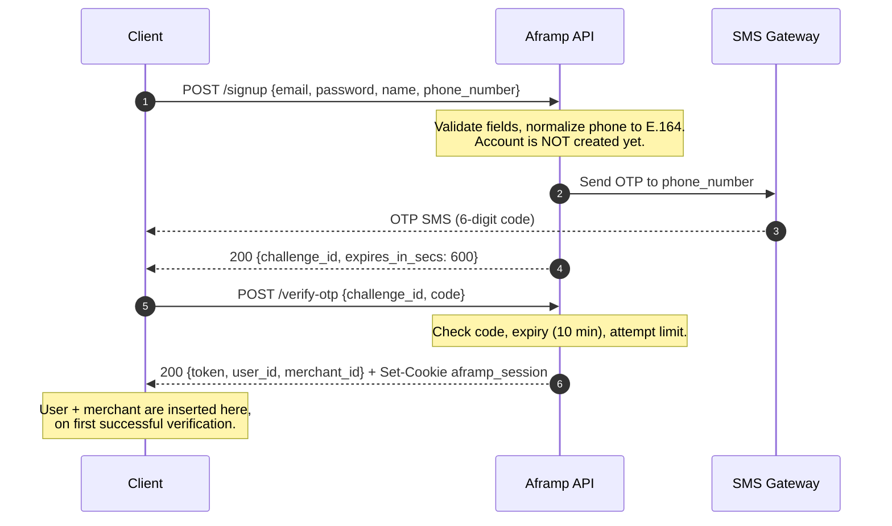
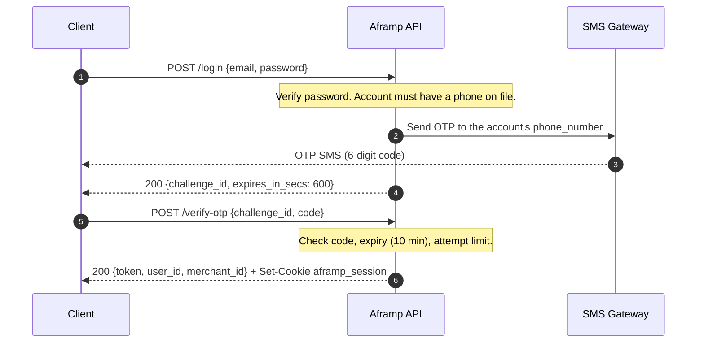

# Aframp Pay — API reference

Everything documented here is implemented and covered by integration tests against a real Postgres database. Where behaviour is partial or stubbed, it's marked inline rather than omitted.

- **Base URL (dev):** `http://127.0.0.1:3000`
- **Content type:** `application/json` on every request with a body
- **Machine-readable spec:** [`openapi.yaml`](openapi.yaml) — generate a typed client from it rather than hand-writing calls

---

## Authentication

There are two ways to authenticate. **Browsers should use the cookie.**

### Session cookie (browsers)

`/signup` and `/login` set an `HttpOnly` session cookie:

```
Set-Cookie: aframp_session=<jwt>; HttpOnly; Path=/; SameSite=Lax; Max-Age=86400; Secure
```

Send subsequent requests with `credentials: 'include'` (or nothing at all if the frontend is served same-origin) and the browser attaches it for you. `POST /logout` clears it.

**Do not store the JWT in `localStorage`.** The token is still echoed in the response body for API clients, but a browser that copies it into `localStorage` hands the whole session to any XSS on the page — which is exactly what the `HttpOnly` cookie exists to prevent. Ignore the `token` field; read the login response only for `user_id` and `merchant_id`.

### Bearer token (API clients, scripts, tests)

Non-browser clients send the JWT from the response body as a header:

```
Authorization: Bearer <token>
```

The header takes precedence when both are present.

Tokens are **HS256, valid for 24 hours** either way. Claims are `sub` (user id), `merchant_id`, `iat`, `exp`.

Two things worth building for up front:

- **`merchant_id` is nullable.** `AuthResponse.merchant_id` and the JWT claim are both optional. Today signup always creates a merchant so it's always present, but the type allows `null` — an account without a merchant gets `400` from every merchant-scoped endpoint, not `401`. Don't assume non-null.
- **Expiry is silent.** There's no refresh endpoint. When a token expires, calls start returning `401` with `{"error":"invalid or expired token","code":"INVALID_CREDENTIALS"}` — treat any `401` on a previously-working call as "send the user back to login."

### CORS

Browser origins must be allowlisted server-side via the `CORS_ALLOWED_ORIGINS` env var (comma-separated, defaults to `http://localhost:3001`). Allowed methods are `GET`/`POST`; allowed headers are `Authorization` and `Content-Type`. Credentials **are** enabled, so the origin list is never mirrored back — an origin that isn't listed fails preflight.

The supported deployment is **same-origin**: serve the frontend and this API behind one hostname (the reverse proxy routes `/api/*` here) and CORS stops applying at all. Cross-origin cookie auth additionally needs `COOKIE_SAME_SITE=none`, which lets the session ride cross-site requests and reintroduces CSRF as something you have to handle. With the default `SameSite=Lax`, a cross-origin frontend won't get the cookie sent at all and has to fall back to the bearer header.

---

## Authentication Flows

Authentication is a **two-step OTP flow**. Neither `/signup` nor `/login` returns a session directly — both return an OTP challenge, and the session is only issued once the code is verified via `POST /verify-otp`. The two flows have the same shape; they differ only in what the first step validates (new credentials vs. an existing password).

### Signup flow



### Login flow



### Resending a code

There is no dedicated resend endpoint. **Re-POST the same `/signup` or `/login` request** to get a fresh challenge and a new SMS:

- **Signup:** re-POST `/signup` with the same body. Because the account isn't created until verification, the same email can be re-submitted freely as long as no prior attempt for it was ever verified. The previous `challenge_id` is superseded — use the new one.
- **Login:** re-POST `/login` with the same credentials. A new challenge is issued and the previous one is superseded.

### Cooldown and hourly limit

Resends are rate-limited per phone number:

- **60-second cooldown** between sends. A resend inside the cooldown returns `429` with code `TOO_MANY_REQUESTS`.
- **5 sends per hour.** The 5th+ send inside the hour returns `429` with code `TOO_MANY_REQUESTS`.

On `429`, show the user the wait and **do not auto-retry** — retrying immediately just burns the limit.

### Code expiry and attempts

- **Codes expire 10 minutes after they're sent** (`expires_in_secs: 600`). Submitting after that returns `400` with code `OTP_EXPIRED` — request a new challenge via the resend path above.
- **5 wrong attempts** on a challenge locks it: `400` with code `OTP_LOCKED`. Request a new challenge.
- A wrong code returns `400` with code `OTP_INVALID`; an unknown or already-consumed `challenge_id` returns `404` with code `OTP_CHALLENGE_NOT_FOUND`.

---

## Errors

Every error returns the same shape — a human-readable `error` string plus a stable, machine-readable `code` you can branch on:

```json
{ "error": "insufficient available balance", "code": "INSUFFICIENT_BALANCE" }
```

`code` is stable and never changes wording; `error` is written for humans. Match on `code`, never on the `error` string.

| Status | Meaning | Frontend handling |
|---|---|---|
| `400` | Validation failed, or the account has no merchant | Show the `error` string; it's written for humans |
| `415` | `Content-Type` isn't `application/json` on a POST/PUT with a body | Send `Content-Type: application/json` and retry |
| `401` | Missing, malformed, or expired token | Redirect to login |
| `404` | Resource not found | — |
| `409` | Email or phone already registered | Show on the signup form |
| `403` | Authenticated, but not an admin (`/admin/*` only) | Not applicable to merchant-facing routes |
| `429` | OTP resent too soon, or too many times this hour | Show the wait; don't auto-retry |
| `502` | Upstream payment provider failed | Transient — the `error` carries the provider's own message |
| `500` | Internal error | Generic `INTERNAL_ERROR`; details stay in server logs |

### Error code catalog

| Code | Status | When it's returned |
|---|---|---|
| `INVALID_PARAMETERS` | `400` | A required field is missing/malformed (e.g. short password, bad account_number/bank_code) |
| `INVALID_AMOUNT` | `400` | Amount is not positive, or not a whole number of kobo |
| `INSUFFICIENT_BALANCE` | `400` | Withdrawal exceeds the available balance |
| `UNSUPPORTED_ASSET` | `400` | Withdrawal asset isn't cNGN |
| `EMAIL_TAKEN` | `409` | Signup email already registered (to a verified account) |
| `PHONE_TAKEN` | `409` | Signup phone already registered (to a verified account) |
| `INVALID_CREDENTIALS` | `401` | Wrong password or unknown email on login |
| `USER_NOT_FOUND` | `404` | Authenticated user no longer exists |
| `MERCHANT_NOT_FOUND` | `400` | Account has no merchant (visit onboarding) |
| `WALLET_NOT_FOUND` | `400` | No wallet yet, or none created before a payment-request call |
| `PAYMENT_REQUEST_NOT_FOUND` | `404` | Payment request id doesn't exist |
| `PAYOUT_FAILED` | `502` | Upstream payment provider rejected the payout |
| `FORBIDDEN` | `403` | Authenticated but not an admin, on an `/admin/*` route |
| `OTP_INVALID` | `400` | Wrong code submitted to `/verify-otp` |
| `OTP_EXPIRED` | `400` | Code submitted after its 10-minute window |
| `OTP_LOCKED` | `400` | 5 wrong attempts on this challenge — request a new one |
| `OTP_CHALLENGE_NOT_FOUND` | `404` | Unknown or already-consumed `challenge_id` |
| `TOO_MANY_REQUESTS` | `429` | OTP resent inside the 60s cooldown, or 5th+ send this hour |
| `INTERNAL_ERROR` | `500` | Unexpected server error; generic message only |

---

## Conventions

**Money is always integer stroops** (`i64`), never a float. 1 unit = `10_000_000` stroops.

```js
const toDisplay = (stroops) => (stroops / 10_000_000).toFixed(7);
const toStroops = (amount) => Math.round(amount * 10_000_000);
```

Never use floating-point arithmetic to accumulate balances — convert for display only.

**Timestamps** are RFC 3339 / ISO 8601 UTC (`2026-08-13T14:15:34.520195Z`), parseable by `new Date()`.

**Ids** are UUID v4 strings.

---

## Endpoints

### `GET /health`
Liveness probe. No auth. Returns `204 No Content` with an empty body.

### `GET /`
Returns the literal string `aframp` (not JSON). Useful as a smoke test.

---

### `POST /signup`
No auth. **Does not create the account.** Validates the credentials, sends an OTP to `phone_number`, and returns a challenge — the user + merchant only get inserted once `POST /verify-otp` succeeds with the right code. This means the same email can be re-submitted freely (it's the resend path) as long as no prior attempt for it was ever verified.

```json
{ "email": "merchant@example.com", "password": "at-least-8-chars", "name": "Shop Name", "phone_number": "08011122233" }
```

`phone_number` accepts any common Nigerian mobile format (`0801...`, `801...`, `+234801...`, `234801...`) and is normalized to E.164 before storage/sending.

`200` →
```json
{ "challenge_id": "b6b54b1e-...", "expires_in_secs": 600 }
```

Errors: `400` if email is empty, password is under 8 characters, name is empty, or the phone doesn't parse. `409` (`EMAIL_TAKEN`/`PHONE_TAKEN`) if either is already registered to a *verified* account. `429` (`TOO_MANY_REQUESTS`) if resent within 60s of the last send, or 5 times inside an hour.

### `POST /login`
No auth. Verifies the password. If the account has a verified phone number, this returns a **fresh OTP challenge** (identical shape to `/signup`'s) instead of a session — full two-factor, every login, no exception for a returning session. Only an account with no phone on file (impossible to create anymore; a relic of accounts made before this existed) logs in synchronously with the old one-step respon

/* … truncated 11855 chars — edit only what you need near the top … */
